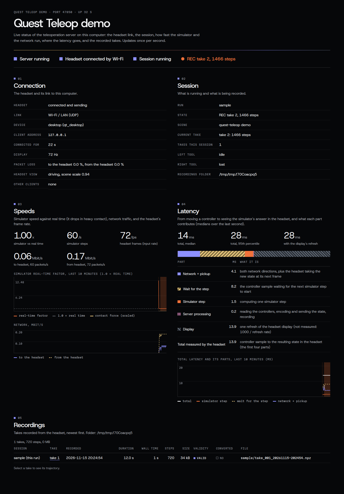
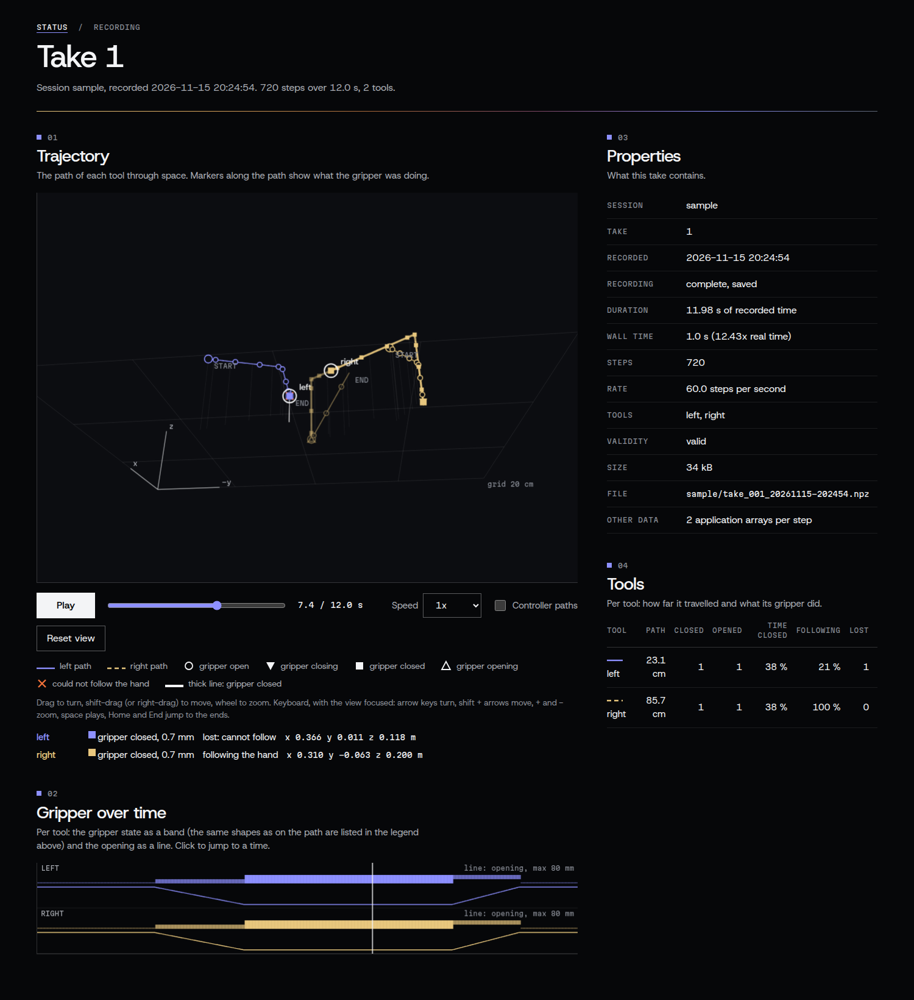
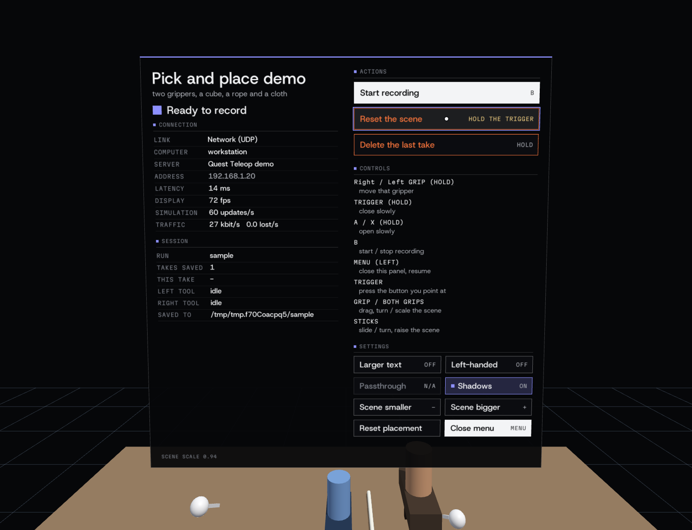
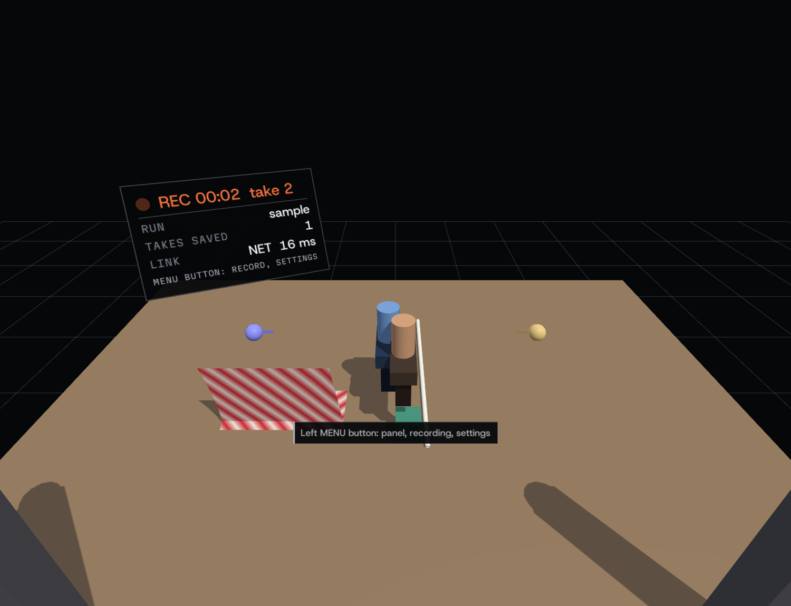
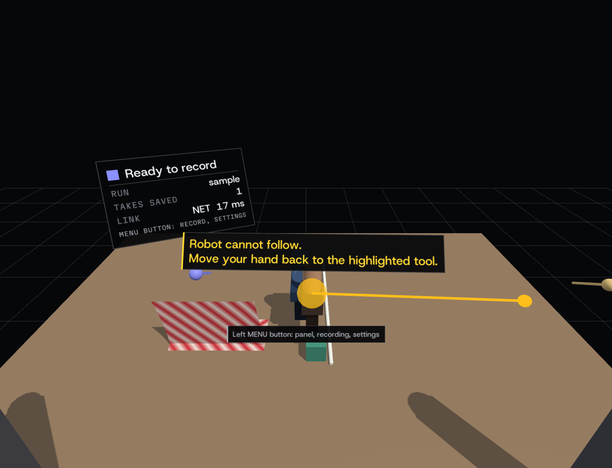

# quest-teleop

Teleoperate anything from a **Meta Quest 2** (or a later Quest), without a game engine: a small native headset
app, a Python library for the computer side, a recorder for the trajectories, and a local web page to watch it all.

**Website and documentation: <https://entangledquantum.github.io/quest-teleop/>.** For an AI coding agent:
"Read https://entangledquantum.github.io/quest-teleop/llms.txt and follow it to install quest-teleop, set up my
Quest 2, and show me how to use it."

* **Headset app** (`client/`): native OpenXR + OpenGL ES 3 in C++ (one `NativeActivity`, no Java, no Gradle). It
  knows nothing about your task. It connects to a server on the local network, receives a 3D scene (meshes and
  colours once, then only what moves), draws it in the room, lets the user move / turn / scale it, sends both
  controllers' poses and buttons every display frame, plays controller vibration, and shows the server's cues,
  status and buttons.
* **Python library** (`quest_teleop`, numpy only): stream any 3D scene, receive the controllers, haptics, text
  cues, a control panel with your own actions, safe hand-to-tool mapping, **recording of takes**, and the
  **status page**.
* **Desktop client** (`client/desktop`): the same C++ core in a window, mouse and keyboard instead of the headset,
  to try a server without a headset.

| Status page | Trajectory of a recorded take |
|---|---|
|  |  |

| Headset menu | Wrist card while recording | "Go back" cue |
|---|---|---|
|  |  |  |

The three headset pictures are drawn by the desktop client (same renderer and UI code as the headset app); all of
them come from the bundled demo (`tools/make_screenshots.sh`).

## Install

```bash
pip install git+https://github.com/EntangledQuantum/quest-teleop      # or, in a clone: pip install .
```

Python 3.10 or newer; the only dependency is numpy. This installs the `quest_teleop` package and two commands,
`quest-teleop-demo` and `quest-teleop-probe`.

The headset app is built from this repository (once):

```bash
android/setup_toolchain.sh        # Android SDK tools, NDK r27c, Khronos OpenXR loader -> ~/android-sdk (2.4 GB)
android/build_apk.sh install      # builds build/quest-teleop.apk (about 1 MB) and installs it over USB
```

`setup_toolchain.sh` downloads only from `dl.google.com` and `github.com/KhronosGroup`, and accepts the Android
SDK licences. The build is NDK clang through CMake, then `aapt2`, `zip`, `zipalign`, `apksigner` with a debug key.

## Quick start

```bash
quest-teleop-demo                 # a mock world: two grippers, a cube to pick and place, a rope, a cloth
```

It prints the status page's address (http://localhost:8800). Then either start **Quest Teleop** in the headset
(Library, filter "Unknown sources"), or try it without a headset:

```bash
cmake -S client -B build/desktop && cmake --build build/desktop -j     # needs X11, EGL and zlib development files
build/desktop/qt_desktop                                               # finds the server by broadcast
```

In the headset: hold a **grip** button to move that gripper, hold the **trigger** to close it, **A / X** to open
it, **B** starts and stops recording a take. The left **menu** button opens the panel (connection, session, your
actions as buttons, control legend, settings) and lets you place and scale the scene with the grips.

Desktop client: right-drag looks, `W A S D Q E` move the head, left-drag moves the active hand (shift: turns it),
wheel moves it nearer / farther, `TAB` switches hand, `G` grip, `T` trigger, `1` / `2` primary / secondary button,
`M` menu, `ESC` quits.

## Use it with your own simulator or robot

```python
from quest_teleop import Scene, TeleopServer, StatusPage, TakeRecorder

scene = Scene("my sim", bounds_min=(-1, -1, 0), bounds_max=(1, 1, 2), up_axis=2,
              focus_center=(0.4, 0, 0.2), focus_radius=0.3, view_dir=(1, 0, 0))
box = scene.add_node("box", scene.add_mesh(vertices, faces, normals))        # rigid
cloth = scene.add_deform("cloth", cloth_vertices, cloth_faces)                # streamed vertices
rope = scene.add_tube("rope", rope_points, radius=0.003)                      # streamed polyline

srv = TeleopServer(name="my sim").start()
srv.set_scene(scene)
rec = TakeRecorder(tools=("left", "right"), max_opening=0.08)                 # ~/teleop_recordings by default
StatusPage(srv, recordings_dir=rec.root).start()                              # http://localhost:8800
while True:
    inp = srv.get_input()                             # newest controller sample, or None
    if inp and not inp.edit_mode and inp.hands[1].active:
        pos, quat = inp.hand_in_scene(1)              # right controller in simulator coordinates
        ...
    sim.step()
    scene.set_pose(box, box_pos, box_quat)
    scene.set_points(cloth, sim.cloth_vertices)
    scene.set_points(rope, sim.rope_points)
    srv.haptic(1, amplitude=0.5, duration=0.03)       # on contact
    rec.add(sim.time, tool_positions, tool_quats, opening=gripper_openings, extra={"my_state": sim.state})
    srv.publish(echo=inp)                             # sends what changed; echo gives the latency measurement
```

The pieces, all in `quest_teleop`:

| Module | What it gives you |
|---|---|
| `Scene`, `TeleopServer` | meshes, deforming meshes, tubes; per-frame poses; haptics; text cues; controller input |
| `Panel`, `Row`, `Action` | the headset's status card and menu: your rows, your buttons (`server.pop_actions()`), your control legend |
| `ToolTeleop`, `RateGripper`, `ContactHaptics`, `GoBackCue` | clutched hand-to-tool mapping with a speed limit and a tether; when the robot cannot follow, it holds and the headset shows where it really is |
| `TakeRecorder`, `load_take`, `take_summary` | recording (below) |
| `StatusPage` | the local web page |
| `quest_teleop.demo` | all of the above in one file, as an example |
| `quest_teleop.probe` | a headless client: tests, latency and bandwidth numbers |

## Recording

`TakeRecorder` writes one `.npz` per take plus an index, by default into `~/teleop_recordings` (argument, or
`TELEOP_DATA_DIR`):

```
teleop_recordings/index.json                       every take: file, session, take, start time, steps, seconds, tools, your info
teleop_recordings/<session>/session.json           what your application says about the session
teleop_recordings/<session>/take_003_<time>.npz
```

| Array (T steps, N tools) | Meaning |
|---|---|
| `t`, `t_wall` (T,) | application time of each step, wall-clock seconds since the take started |
| `tool/pos` (T, N, 3), `tool/quat` (T, N, 4) | measured tool poses, scene coordinates, quaternions xyzw |
| `tool/target_pos`, `tool/target_quat` | commanded tool poses |
| `tool/opening`, `tool/opening_cmd` (T, N) | measured and commanded gripper opening [m] |
| `tool/grip_state` (T, N) | 0 open, 1 closing, 2 closed, 3 opening (given, or derived from the openings) |
| `tool/state` (T, N) | 0 idle, 1 following the hand, 2 lost (could not follow) |
| `ctrl/pos`, `ctrl/quat`, `ctrl/trigger`, `ctrl/squeeze`, `ctrl/buttons` | the controllers |
| `extra/<name>` (T, ...) | your own per-step data (simulator state, sensors, anything) |
| `start/<name>`, `meta` | your state before the first step; JSON with tool names, rate, up axis |

Only `t` and `tool/pos` are required. `load_take(path)` returns the arrays, `take_summary(take)` the path lengths,
gripper events and durations.

## Status page

`StatusPage(server, recordings_dir=...)` serves http://localhost:8800 from the server process: standard library
only, live by server-sent events, static HTML with no build step, nothing loaded from the internet.

* **Connection**: headset connected / worn, USB or Wi-Fi, device, address, packet loss each way.
* **Session**: whatever your `extra` callback reports (run, state, scene, current take ...).
* **Speeds**: simulator real-time factor and steps per second, network Mbit/s and packets/s, headset frames per second.
* **Latency**: total, and its parts: network + pickup, wait for the next simulator step, simulator step, server
  processing (`server.note_timing`), display refresh. Network and "the headset taking the state at its next frame"
  are one part: separating them would need a clock shared with the headset.
* **Recordings**: every take. Selecting one opens the **trajectory view**: each tool's path in 3D (turn, move,
  zoom, play, scrub), the gripper state marked along the path by shape as well as colour (open, closing, closed,
  opening, could not follow), the gripper over time, and the take's properties.

Both pages use real text and tables, shapes plus words for every state, visible keyboard focus, keyboard control
of the 3D view, and text equivalents for the charts.

## In the headset

| | |
|---|---|
| **Wrist card** (above the off-hand controller) | state badge (e.g. `REC 00:12 take 3`), the server's pinned values, link type and latency |
| **REC badge** (head-locked) | while the server reports "recording" |
| **Left menu button** | opens / closes the menu; the server is told and should hold the robot |
| Menu, left column | connection (USB cable or Wi-Fi, computer, server, address, latency, fps, updates per second, traffic) and the server's session rows |
| Menu, right column | the server's actions as buttons, the control legend, settings: larger text, left-handed, passthrough, shadows, scene size, placement |
| Point + trigger | press the button the beam points at; "danger" actions need the trigger held for about a second |
| One grip / both grips (menu open) | drag and turn / scale the scene; left stick slides, right stick turns and raises |

Accessibility: no text below about 0.7 degrees and a larger-text setting; ink on a near-black plate keeps contrast
against passthrough; every state has a shape and words, not only a colour; every action is a labelled button with
its shortcut printed on it; hover and press give a haptic tick as well as a focus frame; nothing needs hand tracking
or standing; left-handed mode swaps the two controllers' roles and the legend text.

Rendering: one shadow-mapped key light, hemisphere ambient, a fill light, Fresnel-weighted specular, a rim
highlight for nodes the server flags. On a Quest 2 passthrough is grey-scale; without passthrough a floor grid is
drawn.

## Quest 2 setup

1. **Developer mode** (once): in the Meta Horizon phone app, logged in with the headset's account, create or join a
   developer organisation (<https://developers.meta.com/horizon/manage/organizations/create/>) and verify the
   account. Then Menu, Devices, the headset, Headset settings, Developer mode: on. Reboot the headset.
2. **USB**: connect the headset to the computer with a USB-C data cable and put it on. Tap the "USB detected"
   notification and allow access; then accept "Allow USB debugging" (tick "Always allow from this computer").
   Turn "Link auto connect" / "Turn on Link" off, or the headset tries to start Link instead.
3. `~/android-sdk/platform-tools/adb devices` must list the headset as `device`. On Linux, if it shows
   `no permissions`: `echo 'SUBSYSTEM=="usb", ATTR{idVendor}=="2833", MODE="0666", GROUP="plugdev"' | sudo tee
   /etc/udev/rules.d/51-oculus.rules && sudo udevadm control --reload-rules && sudo udevadm trigger`, then replug.
4. `android/build_apk.sh install`. The app is under Library, filter "Unknown sources", as "Quest Teleop".
5. **Network**: headset and computer on the same router (headset on 5 GHz, no guest network / client isolation).
   Open **TCP 47800 and UDP 47800-47801** in the computer's firewall, e.g. `sudo ufw allow 47800/tcp && sudo ufw
   allow 47800:47801/udp`, or `sudo firewall-cmd --add-port=47800/tcp --add-port=47800-47801/udp` (add
   `--permanent` and `--reload` to keep it). The app finds the server by itself.
6. **USB instead of Wi-Fi**: `adb reverse tcp:47800 tcp:47800`. The app then reaches the server on its own loopback
   and tunnels everything through TCP.

Launch options: `adb shell am start -n com.entangledquantum.questteleop/android.app.NativeActivity --es server
192.168.1.20` (explicit address), `--es hz 90` (display rate; default is the system's 72 Hz), `--es passthrough 0`.

## Protocol

[docs/PROTOCOL.md](docs/PROTOCOL.md): TCP for the handshake, the scene, the panel and text; UDP for controller
input and state. State frames carry absolute 16-bit values of only what changed since the frame the client last
acknowledged, so static things cost nothing and a lost datagram heals on the next frame. Numbers:
[docs/MEASUREMENTS.md](docs/MEASUREMENTS.md).

## Layout

```
client/core            portable C++: protocol, network thread, scene, GLES3 renderer, UI
client/quest           OpenXR + EGL + NativeActivity entry point, AndroidManifest.xml
client/desktop         X11 / EGL window and off-screen entry point
android/               setup_toolchain.sh, build_apk.sh
server/quest_teleop    the Python library (protocol, scene, server, panel, teleop logic, cues, recording, status page, demo, probe)
tests/                 pytest: protocol round trips, server and probe over loopback, packet loss, recording, status page
tools/                 font atlas generator, site generator, screenshot and check scripts, the fonts
docs/                  PROTOCOL.md, MEASUREMENTS.md, img/
site/                  the GitHub Pages site: landing page, docs as HTML and Markdown, llms.txt (tools/build_site.py)
```

```bash
pip install pytest && python -m pytest -q
```

## Licence

MIT (see [LICENSE](LICENSE)). Third-party: the Khronos OpenXR loader (Apache-2.0 / MIT, downloaded at build time
and shipped in the APK), the Android NDK's `native_app_glue` (Apache-2.0), zlib, and the fonts Host Grotesk and
Martian Mono (SIL Open Font License 1.1, [tools/fonts/OFL.txt](tools/fonts/OFL.txt)).
